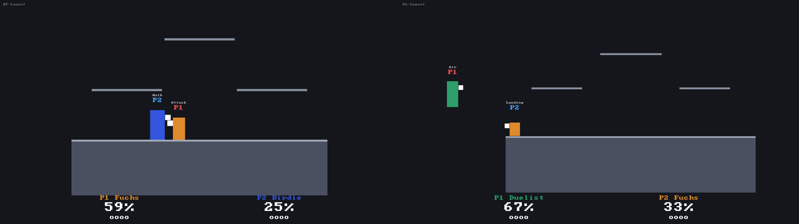

# proto1v1

Eigenständiger 1-gegen-1-Prototyp mit Melee-artiger Bewegung, vier Kämpfern und den fünf
neutralen Stage-Layouts. Die Grafik besteht aus Platzhaltern (Rechtecke). Es werden **keine Assets,
kein ISO und kein Code aus dem Spiel** verwendet, nur öffentlich dokumentierte Zahlenwerte.
Läuft unter Windows, Linux und macOS und baut mit GCC, Clang oder MSVC.



## Download

Unter **Releases → „Neuester Build“** liegt nach jedem Push automatisch:
- `proto1v1-windows-x64.zip`
- `proto1v1-linux-x64.tar.gz`
- `proto1v1-macos-universal.zip` (unsigniert; beim ersten Start Rechtsklick → Öffnen)

## Kämpfer

Die Bewegungswerte entsprechen den dokumentierten Melee-Attributen (SmashWiki, NTSC): Gewicht,
Dash, Run, Walk, Traction, Luftgeschwindigkeit, Luftbeschleunigung, Luftreibung, Gravitation, Fall-
und Fastfall-Speed, Jumpsquat sowie Full-Hop-, Short-Hop- und Doppelsprung-Höhe.

| Name | Vorbild |
|---|---|
| Fuchs | Fox |
| Birdie | Captain Falcon |
| Assassin | Sheik |
| Duelist | Marth |

Noch Platzhalter: Hurtbox-Größen, Walk-Beschleunigung und die Angriffe. Alle Kämpfer teilen sich
Jab, Strong und Nair mit eigenen Werten.

## Stages

BF-, FD-, YS-, DL- und FoD-Layout mit gemessenen Kantenpositionen, Plattformhöhen und -breiten und
Blastzones. Die FoD-Seitenplattformen stehen fest. Die Unterseiten der Hauptplattformen sind
vereinfacht.

## Steuerung

| | GameCube-Controller / Gamepad | Tastatur P1 | Tastatur P2 |
|---|---|---|---|
| Bewegen | Stick | WASD (Shift = Gehen) | Pfeile (RShift = Gehen) |
| Angriff | A (Stick zur Seite = Strong) | J | Num 1 |
| Sprung | X / Y / Stick hoch | Space / I | Num 0 / Num 5 |
| Airdodge / Wavedash | L / R | L | Num 2 |
| Pause | Start | Enter | Num Enter |

F1 zeigt Zustände an, Esc führt zurück ins Menü. Im Menü lässt sich P2 auf CPU stellen.

Funktionen: Dash, Dashdance, Run, Turn, Crouch, Short Hop und Full Hop, Doppelsprung, Fastfall,
Airdodge, Wavedash, Waveland, Plattform-Drop, Ledge-Grab mit Getup und Ledge-Jump, Knockback mit
Hitstun, KOs und 4 Stocks.

### GameCube-Adapter (offizieller / Mayflash im Wii-U-Modus)
- **Windows:** Den WinUSB-Treiber mit Zadig installieren, genau wie für Dolphin.
- **Linux:** Die udev-Regel aus der Dolphin-Doku einrichten, damit der Adapter ohne root lesbar ist.
- **macOS:** Funktioniert in der Regel direkt.

## Selbst bauen

```sh
cmake -S . -B build -DCMAKE_BUILD_TYPE=Release   # SDL3 wird bei Bedarf automatisch geladen
cmake --build build --config Release
ctest --test-dir build -C Release                # Headless-Physiktests
./build/proto1v1
```

Ohne Fenster lässt sich ein Bild rendern:
`proto1v1 --screenshot out.bmp --stage 1..5 --frames 600 --p1 0..3 --p2 0..3`.

## Aufbau

- `src/core/`: Simulation ohne Abhängigkeiten (fester 60-Hz-Takt, deterministisch)
- `src/app/main.c`: SDL3-Frontend (Fenster, Eingabe, Platzhalter-Grafik, Menü)
- `tests/sim_test.c`: prüft Sprunghöhen gegen die Melee-Werte, Wavedash, Ledge, Treffer und
  komplette CPU-gegen-CPU-Matches auf allen Stages
